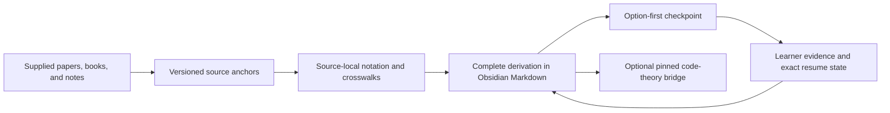

# theoretical-physics-teach

[English](README.md) · [简体中文](README.zh-CN.md)

[](https://github.com/jiangweiqi001/theoretical-physics-teach/actions/workflows/validate.yml)

> Read the paper. Preserve the notation. Finish the derivation. Resume exactly where you stopped.

`theoretical-physics-teach` is an independent Agent Skill created, maintained, and published by [jiangweiqi001](https://github.com/jiangweiqi001). This repository is its canonical development and release line. It is configured as an explicit-only skill in Codex for sustained study of theoretical physics from user-supplied papers, textbooks, lecture notes, and related implementation material.

It is source-driven and multi-source. It preserves each source's notation, records explicit translations and assumptions between sources, and writes durable, Obsidian-compatible Markdown lessons with long, step-by-step derivations when needed. Formal tools and proof steps are developed inside the physical argument that requires them.

Codex does not activate the skill automatically because `agents/openai.yaml` disables implicit invocation. Invoke it with the exact `$theoretical-physics-teach` mention, for example “用 `$theoretical-physics-teach` 学这些论文”. In ChatGPT, type `@` and select the skill from the picker.

## Start here

- [Five-minute start](#five-minute-start)
- [Why this skill exists](#why-this-skill-exists)
- [Strengths and practical boundaries for researchers](#strengths-and-practical-boundaries-for-researchers)
- [What happens when you say “this step is unclear”](#what-happens-when-you-say-this-step-is-unclear)
- [Installation](#installation)
- [Workspace artifacts](#workspace-artifacts)
- [Optional code-theory bridge](#optional-code-theory-bridge)
- [Validation](#validation)
- [Architecture](https://github.com/jiangweiqi001/theoretical-physics-teach/blob/main/docs/architecture.md) and [end-to-end walkthrough](https://github.com/jiangweiqi001/theoretical-physics-teach/blob/main/docs/walkthrough.md)
- [Release history](https://github.com/jiangweiqi001/theoretical-physics-teach/blob/main/CHANGELOG.md)

## Five-minute start

1. Choose a writable learning directory in an Obsidian vault. Keep it outside the installed Skill directory.
2. Supply one or more papers, books, lecture notes, or trustworthy corresponding code paths.
3. Invoke the Skill explicitly and state the physical goal, explanatory language, and capability you want to demonstrate.

```text
$theoretical-physics-teach

Learning workspace: D:\Obsidian\UEG-field-theory\study
Materials: D:\papers\paper-A.pdf and D:\papers\paper-B.pdf
Goal: understand how their Green-function derivations and approximations correspond.
Preserve each source's notation, diagnose one prerequisite at a time, and write
complete Obsidian Markdown lessons with exact resume state.
```

The first run creates only missing canonical workspace files. A later run reads the mission, atomic current state, active lesson, and latest evidence before continuing. See the validator-backed [retarded-propagator example](https://github.com/jiangweiqi001/theoretical-physics-teach/blob/main/examples/retarded-propagator/MISSION.md) for the complete lifecycle.

## Why this skill exists

Theoretical-physics papers are rarely difficult because of one isolated formula. The difficulty is the chain: a convention introduced ten pages earlier, a skipped contour step, a regulator removed in a particular order, a symbol reused differently by another paper, and a numerical loop that only makes sense after the approximation is reconstructed.

A stateless summary can describe that chain. It cannot reliably remember which link you personally understand, which sign still bothers you, or which explanation must become part of the permanent lesson. This skill treats paper study as an evolving research notebook: sources stay anchored, notation stays local, derivations stay auditable, and every substantive clarification is written back into the Note where it logically belongs.

中文简介：这是一个面向理论物理论文精读的长期教学 skill。它不追求把论文快速概括完，而是帮助你保留原文符号、补全推导、跨论文比较，并从上次卡住的公式继续学习。

## A serious paper-reading workflow



The loop matters: the next session does not restart the chapter. It reopens the exact Note heading or equation block, reads the last demonstrated boundary, and continues with one next action.

The current owner graph and compatibility boundary are documented in [Architecture](https://github.com/jiangweiqi001/theoretical-physics-teach/blob/main/docs/architecture.md). The [exact-resume walkthrough](https://github.com/jiangweiqi001/theoretical-physics-teach/blob/main/docs/walkthrough.md) shows a learner reporting one unclear step and the resulting in-place Note rewrite.

## Who this is for

This skill is primarily for students, independent learners, and researchers who want to understand the theory in one or more theoretical-physics sources, not merely obtain a short summary. It is particularly suitable when you need to:

- work through condensed-matter field theory, quantum field theory, many-body theory, renormalization-group arguments, and the formal prerequisites required by those theories;
- read several papers or chapters together even when they use conflicting notation, conventions, approximations, or energy variables;
- see long derivations with every algebraic and logical transition made explicit;
- maintain a durable Obsidian learning workspace that can resume from the exact unresolved step; or
- connect equations and approximations to supplied pseudocode or research code without inventing execution results.

This project is for theoretical physics only. Formal tools, theorem statements, and proof steps are developed when a physical argument requires them; they are not presented as a separate curriculum or audience. This is not a quick paper-summarization skill.

## Strengths and practical boundaries for researchers

For a researcher entering another theoretical-physics subfield through deep paper reading, the useful feature is not artificial compression. It is the removal of repeated orientation work while the full theoretical chain remains inspectable.

| Strength | Practical boundary |
| --- | --- |
| **Prior research training.** A one-dependency-at-a-time diagnosis can reuse demonstrated field-theory, many-body, analytical, or computational background instead of reteaching it. | Background self-report guides the route but is not mastery evidence. A capability is treated as demonstrated only when the corresponding observable task supports it. |
| **Source-faithful reading.** Source-local notation, conventions, version keys, and exact anchors make it possible to follow an unfamiliar paper without silently rewriting it into a generic house notation. | The Skill can be only as complete as the registered source corpus. It does not guarantee that the supplied papers cover the whole subfield or represent every current viewpoint. |
| **Derivation depth.** Intermediate algebra, transforms, sums, limits, assumptions, and physical checks remain available for reconstruction. | This is not an instant-summary workflow. Required steps are not removed merely to create a faster-looking answer. |
| **Cross-source reasoning.** Notation crosswalks and qualified Relations expose when two sources agree, differ by convention, use different approximations, or genuinely conflict. | The Skill does not manufacture consensus. A conflict remains unresolved until anchored evidence establishes the assumptions, regime, or correction that resolves it. |
| **Durable learning state.** Exact resume links and coherent in-place clarification writeback prevent repeated explanations and lost stopping points across sessions. | Persistent state is not a correctness guarantee. Source checking, independent calculation, physical judgment, and expert review remain necessary. |
| **Code-theory provenance.** When trustworthy corresponding material exists, equations, approximations, discretization, physical quantities, code variables, and outputs can be traced together. | Without a canonical Run record and inspected output, the Skill makes no claim that code executed, agreed with theory, or converged. |

The speed comes from avoiding repeated orientation, notation loss, and reteaching—not from skipping the theory or shortening required derivations.

## What it does

- Registers supplied sources with stable IDs, versions, availability, and exact anchors before teaching from them.
- Preserves source-local notation and records translations in `NOTATION-CROSSWALK.md` instead of silently normalizing conventions.
- Compares assumptions, methods, approximations, results, and validity regimes in `SYNTHESIS.md`.
- Starts every lesson Note with `## Notation and conventions` and explains every new symbol before its first use.
- Shows intermediate algebra, transforms, integrals, sums, sign changes, assumptions, and logical implications without imposing a Note length cap or skipping derivation steps.
- Resumes from the exact recorded obstacle and writes substantive clarifications back to the canonical workspace.
- Advances mastery only from observable learner evidence, not confidence, recognition, or rereading alone.

## What happens when you say "this step is unclear"

The explanation is not allowed to disappear into chat history. The skill:

1. reads the complete active Note and exact resume state;
2. finds the first sentence or equation that depends on the missing idea;
3. updates the leading notation section before introducing new symbols;
4. inserts the explanation at that point and rewrites both surrounding transitions;
5. removes stale pause text, duplicate work, and local contradictions;
6. repairs affected numbering, provenance, Note links, and the final checkpoint; and
7. records the new exact section or block link in `CURRENT-STATE.md`.

The finished Note should read as if the clarification had been designed there from the start—not like a transcript pasted onto the end.

## Stateless summary vs. this skill

| Need | Stateless paper summary | `theoretical-physics-teach` |
| --- | --- | --- |
| Paper notation | Often normalized for convenience | Preserved per source, with explicit crosswalks |
| Derivation depth | Usually compresses intermediate work | No Note length cap and no skipped calculation or logic steps |
| “I do not understand this step” | Explanation remains in chat | Explanation is integrated coherently into the canonical Note |
| Next session | Depends on conversation memory | Reopens an exact Note heading or equation block |
| Multiple papers | Summarizes each independently | Records assumptions, relations, conflicts, and regimes across sources |
| Assessment | Often asks generic review questions | Defaults to one diagnostic option/true-false item, then produced work when required |
| Mastery | May infer understanding from agreement | Advances only from observable learner evidence |
| Code | May describe a plausible implementation | Uses only trustworthy corresponding material and separates inspection from execution claims |

## How this differs from the earlier PR-oriented prototype

The earlier [PR-oriented prototype](https://github.com/jiangweiqi001/skills/commit/14a2dc2) was a two-file change on a fork of the general-purpose upstream `teach` skill. It mainly replaced HTML lessons with Obsidian-compatible Markdown and added limited guidance for notation-heavy physics. The earlier prototype did not become an upstream pull request.

This independent project turns that initial experiment into a dedicated theoretical-physics learning system:

- It provides a complete canonical workspace with 16 maintained Markdown templates instead of patching two files in a general teaching skill.
- It treats multiple papers, textbooks, lecture notes, and code sources as one study corpus while preserving each source's local notation.
- It maintains explicit notation crosswalks, six classified kinds of cross-source relation, assumptions, validity regimes, and unresolved conflicts.
- It records an exact resume point, immutable learner evidence, mastery gates, source versions, and stable source anchors across sessions.
- It includes a code–theory bridge with equation-to-code provenance and explicit non-claims when code has not actually been run or validated.
- It ships static, bootstrap, extraction-isolation, behavioral scenario, and read-only workspace validation tests for the teaching contracts.
- It follows the general Agent Skills package structure, adds Codex metadata, and is released and maintained from this repository.

The current project, architecture, templates, protocols, tests, releases, and ongoing maintenance belong to this independent repository. The earlier fork branch is historical context, not this repository's release lineage.

## Installation

Codex is the primary tested environment. Its personal skills directory is `$HOME/.agents/skills`; on Windows, the equivalent is `%USERPROFILE%\.agents\skills`. Clone the complete public repository there.

PowerShell:

```powershell
$skillsDirectory = Join-Path $env:USERPROFILE ".agents\skills"
New-Item -ItemType Directory -Force -Path $skillsDirectory | Out-Null
git clone https://github.com/jiangweiqi001/theoretical-physics-teach.git (Join-Path $skillsDirectory "theoretical-physics-teach")
```

macOS or Linux:

```sh
mkdir -p "$HOME/.agents/skills"
git clone https://github.com/jiangweiqi001/theoretical-physics-teach.git "$HOME/.agents/skills/theoretical-physics-teach"
```

Alternatively, invoke `$skill-installer` in Codex and ask it to install the skill from `https://github.com/jiangweiqi001/theoretical-physics-teach`. You may also download the runtime-only ZIP attached to the latest GitHub Release. The archive stores runtime files at its root: create a `theoretical-physics-teach` directory and extract the archive contents into that directory under your personal skills directory. Keep the root `SKILL.md`, `references/`, `assets/`, and metadata together.

For another Agent Skills-compatible tool, place the entire repository folder in that tool's skills directory and confirm that it discovers the root `SKILL.md`. `agents/openai.yaml` is Codex-specific display and invocation-policy metadata; the Markdown instructions and supporting files are portable, but another host must provide or be configured with an equivalent explicit-only policy. If it cannot, automatic invocation behavior is not guaranteed there.

### Updating an existing installation

If the installed folder is a Git clone:

```powershell
git -C "$env:USERPROFILE\.agents\skills\theoretical-physics-teach" pull --ff-only
```

Otherwise, download the new release and copy its files over the existing skill folder without deleting your separate learning workspace. Course Notes must never live inside the installed skill directory.

The `v0.4.0` upgrade performs no automatic workspace migration. Existing pre-v0.4 Code Maps embedded in lessons remain valid; newly allocated maps use focused external files.

## First sustained study session

1. Choose a learning workspace in your Obsidian vault or another writable directory. It must be outside the installed skill directory.
2. Supply the papers, textbooks, lecture notes, or other study material. Multiple sources are welcome; give local paths or otherwise place their content explicitly in scope.
3. Include the exact `$theoretical-physics-teach` mention and state the workspace, physical learning goal, materials, preferred explanatory language, and desired observable capabilities.
4. Continue in later sessions from `CURRENT-STATE.md`; learning files stay in the designated workspace and are never written into the installed skill folder.

Example with two papers that use different conventions:

```text
$theoretical-physics-teach

Use D:\Obsidian\many-body-course as my learning workspace.
Study these supplied papers together:
- D:\papers\paper-A.pdf, which writes G(k,\omega) and measures energy relative to \mu
- D:\papers\paper-B.pdf, which writes \mathcal G(p,p_0) and uses absolute energy

Teach me how their Green-function derivations are related. Preserve each paper's
symbols, build NOTATION-CROSSWALK.md and SYNTHESIS.md, and state the assumptions
behind every cross-source relation. Start each lesson with notation and conventions,
define every new symbol before use, and show the complete derivations without a
length cap or skipped steps.
```

### What an Obsidian-native lesson looks like

The canonical artifact is ordinary Markdown—not a generated webpage:

```markdown
# Lesson L-000004 — Free retarded propagator

## Notation and conventions

- $\xi_k=\varepsilon_k-\mu$ is the band energy measured from the chemical potential.

## Complete derivation

With the paper's Fourier convention,

$$
G_0^R(k,\omega)=\frac{1}{\omega-\xi_k+i0^+}.
$$

^eq-free-retarded-propagator

Continue from [[lessons/L-000004-free-retarded-propagator#^eq-free-retarded-propagator|the exact propagator equation]], or review [[lessons/L-000003-fourier-transform#Convergence factor|why the regulator is removed last]].
```

For multi-line work, the skill uses `\begin{aligned}...\end{aligned}` inside `$$...$$`. It does not hide a derivation in a code fence or a fragile Markdown table.

## Workspace artifacts

| Path | Purpose |
| --- | --- |
| `MISSION.md` | Physical questions, constraints, supplied sources, and observable completion targets |
| `CURRENT-STATE.md` | Exact resume point, current obstacle, required anchors, and next action |
| `MATERIALS.md` | Source registry with stable IDs, versions, paths, roles, and availability |
| `ROADMAP.md` | Prerequisite-ordered phases, source anchors, mastery targets, and exit evidence |
| `lessons/*.md` | Dependency-sized teaching Notes with notation first and complete derivations |
| `learning-records/EV-*.md` | Immutable learner evidence and evidence-based mastery judgments |
| `NOTATION-CROSSWALK.md` | Source-local symbols, conventions, domains, dimensions, and qualified translations |
| `SYNTHESIS.md` | Cross-source relations, assumption maps, comparisons, and regimes of validity |
| `OPEN-QUESTIONS.md` | Missing evidence, ambiguities, conflicts, and their next verification steps |
| `reference/code-maps/*.md` | Optional canonical equation-to-code maps when the code bridge is active |
| `execution-records/RUN-*.md` | Optional immutable records of actual runs and observed outputs |

The workspace may also include baseline diagnostics, a concept map, glossary, review queue, preferences, static assets, and other source-grounded reference Notes.

## Optional code-theory bridge

The code bridge is used only when implementation is a learning target and trustworthy corresponding material exists: an official or author-associated open-source repository at a pinned commit, a user-supplied immutable snapshot, or anchored pseudocode sufficient for the mapping. It does not invent generic code for a paper that has no corresponding implementation.

Theory comes first. The optional final implementation section then traces each physical quantity through:

```text
source equation → approximation → discretization → code variable
→ units/domain/shape/indices → initialization/update → output → validation observable
```

Pedagogical pseudocode is labeled **Reconstructed** and linked to the pinned implementation steps from which it was derived. Each loop or solver step is explained as a physical accumulation, contraction, propagation, update, or self-consistency operation.

New canonical mappings are instantiated from `assets/templates/CODE-MAP.md`; real inspected executions are recorded from `assets/templates/RUN-RECORD.md`. The lesson itself retains only the learner-facing quantity chain, algorithm explanation, inputs, outputs, validation boundary, and canonical links. Existing maps embedded in older lessons remain readable and are not rewritten automatically.

Git material is anchored to an exact commit. Non-Git files, chat excerpts, and inline pseudocode are first saved as read-only workspace snapshots with a recorded hash, received date, and exact locator. Without a linked Run record, the skill does not claim that code ran, results agreed, or a computation converged.

## Assessment without fake mastery

Initial diagnosis, ordinary checks, and the end of every learner-facing Note default to one multiple-choice or true/false item at a time. Distractors are designed around specific misconceptions rather than filler, and the correct position is varied.

An option answer can locate a sign, convention, assumption, limiting case, or next-step boundary. It cannot by itself prove that the learner can reconstruct a derivation. When the target is a proof, calculation, cross-source translation, or implementation explanation, the skill follows with the smallest necessary produced-work task and records assisted work separately from unaided work.

## Validation

In a development clone, the repository ships deterministic contracts for package structure, inert bootstrap templates, evaluator isolation, accepted behavioral outputs, and real-workspace Markdown links. Run the full suite from the repository root:

```powershell
./tests/static-contract.ps1
./tests/bootstrap-contract.ps1
./tests/scenario-contract.ps1
./tests/green-contract.ps1
./tests/example-contract.ps1
python -X utf8 -m unittest discover -s tests -v
```

Validate a learning workspace without modifying it:

```powershell
python -X utf8 scripts/validate_workspace.py "D:\Obsidian\many-body-course"
```

The runtime-only release ZIP includes this read-only workspace validator, but intentionally excludes the development tests and package builder.

Build the deterministic runtime-only release ZIP:

```powershell
python -X utf8 scripts/build_skill_package.py --output dist/theoretical-physics-teach-v0.4.0.zip
```

The validator detects unresolved Note, heading, and block links; duplicate block IDs; forbidden math delimiters; obvious code-fenced mathematics; and non-Markdown canonical lesson/reference artifacts. It does not compile LaTeX or prove mathematical correctness, so the skill separately audits notation dependencies, derivations, assumptions, dimensions, limits, symmetries, and physical interpretation.

## Limitations

- Canonical teaching artifacts are Obsidian-compatible Markdown only. The skill does not create HTML, CSS, JavaScript, or browser-dependent lessons, and it requires no website or browser presentation.
- This skill supplements rather than replaces the original materials, independent calculation, or expert review. Its output is not a guarantee of correctness.
- It does not invent missing equations, citations, conventions, code behavior, or evidence. Unavailable or conflicting evidence remains explicitly unresolved.
- It does not silently reconcile contradictory notation, assumptions, approximations, or results.
- Mastery and completion require observable evidence of the stated capability; confidence or recognition alone is insufficient.
- Formal prerequisites are taught only within an identified physical dependency and remain tied to that physical use.
- It remains explicit-only and will not start merely because a conversation happens to mention theoretical physics.

## License and attribution

This independent project is authored, maintained, and published by [jiangweiqi001](https://github.com/jiangweiqi001). Its present theoretical-physics architecture, workspace model, templates, protocols, tests, releases, and ongoing development are maintained here.

Some initial material was adapted from Matt Pocock's MIT-licensed [`teach` skill](https://github.com/mattpocock/skills/tree/84fdeffd12f2ee307994d1eb6feb48173b6e0502/skills/productivity/teach) in [`mattpocock/skills`](https://github.com/mattpocock/skills). The upstream copyright and license notice are retained as required; this legal attribution does not make this repository an upstream-managed project or a pending patch to `teach`.

This is an independent project and is not endorsed by Matt Pocock. See [NOTICE.md](NOTICE.md) for the derivative-work notice and [LICENSE](LICENSE) for the MIT terms.

## Version

Current release: `v0.4.0`.

This maintained release line is dedicated to sustained, source-driven theoretical-physics study in Obsidian. See [CHANGELOG.md](https://github.com/jiangweiqi001/theoretical-physics-teach/blob/main/CHANGELOG.md) for compatibility and release details.
