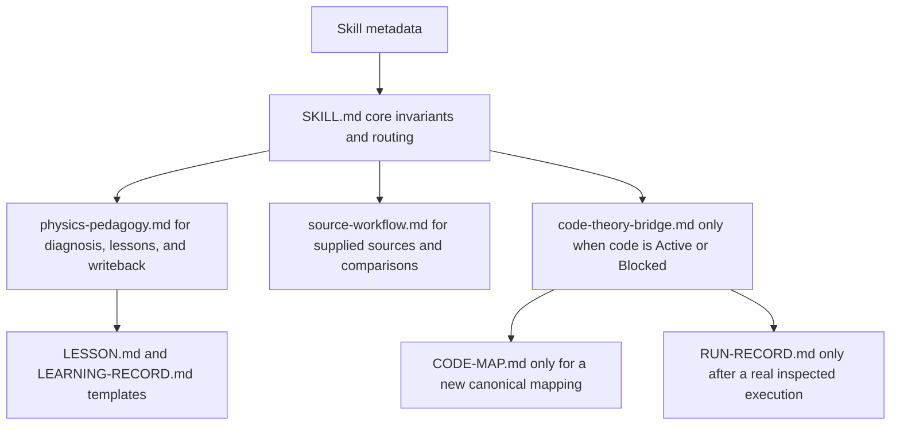
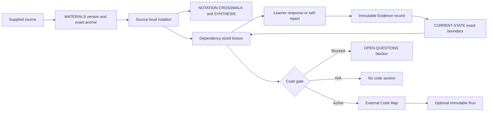

# Architecture

[English README](../README.md) · [简体中文说明](../README.zh-CN.md) · [End-to-end walkthrough](walkthrough.md)

This document describes the current `v0.4.0` runtime architecture. Historical design records under `docs/superpowers/` are development history, not instructions loaded by the Skill.

## Progressive loading

`SKILL.md` keeps rules needed in every teaching turn. Detailed protocols and conditional schemas are loaded only when their gate is active. This keeps an ordinary theory lesson independent of Code Map and Run registry machinery.

## Learning-state flow

## Canonical ownership

| Artifact | Owns | Must not own |
| --- | --- | --- |
| `MISSION.md` | Physical targets, scope, observable completion rows | Learner history |
| `CURRENT-STATE.md` | One live atomic snapshot and exact next action | Historical transcript |
| `MATERIALS.md` | Stable source IDs, versions, availability, paths, and roles | Teaching explanations |
| `lessons/*.md` | Teaching content, derivations, local notation, checks, links to evidence and optional maps | Complete learner history or Run payloads |
| `learning-records/EV-*.md` | Immutable responses, self-report, assistance, mastery judgment, and evidence-caused history | Live state |
| `NOTATION-CROSSWALK.md` | Source-local symbol entries and qualified cross-source symbol relations | General cross-source result comparisons |
| `SYNTHESIS.md` | Relation registry, assumption maps, methods, results, regimes, and conflicts | Lesson-local exposition |
| `OPEN-QUESTIONS.md` | Missing evidence and conflict lifecycle | Resolved claims without anchors |
| `reference/code-maps/*.md` | New canonical theory-to-code architecture, quantity chains, operations, and lifecycle | Observed execution payload |
| `execution-records/RUN-*.md` | Immutable commands, environment, output, convergence, and execution evidence | Theory-source provenance |

## Exact resume and coherent writeback

A teaching turn reads the complete active lesson and the exact state snapshot before editing. When a learner reports a gap, the writeback finds the first sentence, equation, proof step, or code operation that depends on the missing idea. It updates leading notation first, rewrites the transition into and out of the clarification, removes stale wording and duplication, repairs local links and numbering, and then replaces the atomic current snapshot.

The history remains in immutable Evidence records. `CURRENT-STATE.md` contains only the current boundary.

## Code gate

| State | Condition | Result |
| --- | --- | --- |
| Active | Implementation is a mission target and trustworthy corresponding material is anchored | May create an external Code Map; may create a Run only after inspected execution |
| Blocked | Implementation is required but corresponding material is missing | Create or link an Open Question; no Code Map; dependent mission row remains open |
| N/A | Implementation is outside the mission | Omit the learner-facing code section and create no map |

Trustworthy corresponding material means official or author-associated open-source code at an exact commit, a user-supplied immutable snapshot, or anchored pseudocode sufficient for mapping. Similar but unrelated code is not a substitute.

## Compatibility boundary

| Workspace content | v0.4 behavior |
| --- | --- |
| Pre-v0.4 lesson with an embedded lesson-local Code Map | Read and preserve it as a valid legacy canonical record |
| New mapping | Instantiate `assets/templates/CODE-MAP.md` under `reference/code-maps/` |
| Existing Run record | Preserve its immutable payload and lifecycle |
| New real execution | Instantiate `assets/templates/RUN-RECORD.md` under `execution-records/` |
| Mixed old and new records | Follow links and owners; do not migrate automatically |

Bootstrap creates only missing root singleton documents and never overwrites an existing workspace file. Course workspaces always remain outside the installed Skill directory.

## Validation boundary

The read-only validator checks structural properties that can be enforced deterministically: UTF-8, canonical Markdown artifacts, Obsidian links, block IDs, required lesson boundary headings, math delimiters, and code-fenced mathematics.

It does not prove algebra, physics, source correctness, or recursive symbol completeness. Those remain explicit pre-delivery audits backed by the normative [retarded-propagator lesson](../examples/retarded-propagator/lessons/L-DEMO-0001-free-retarded-propagator.md).
